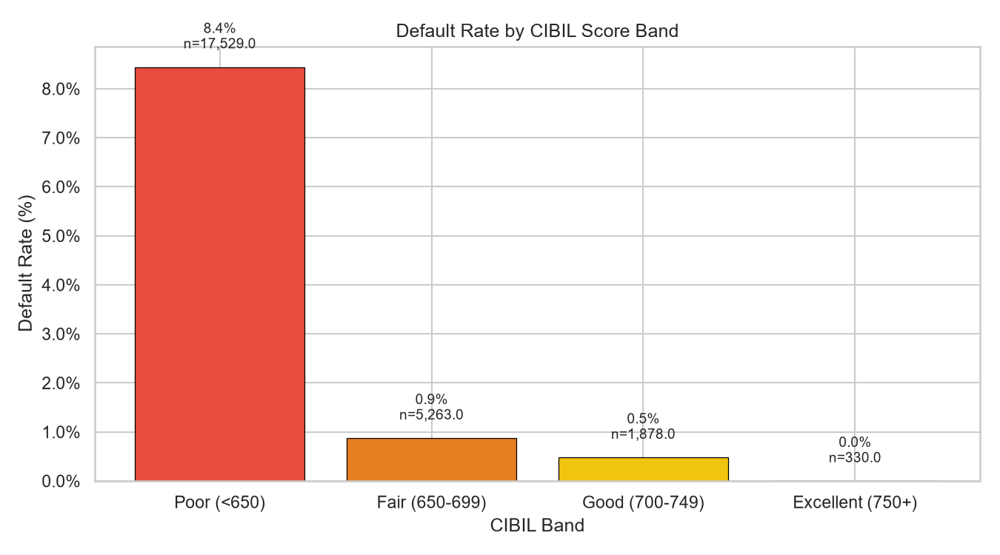
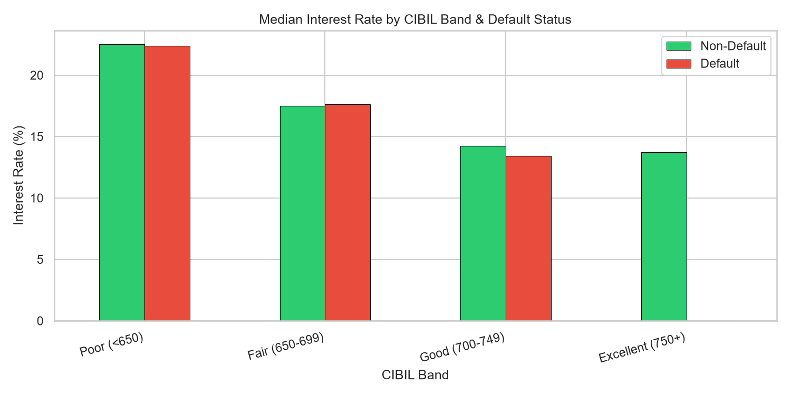
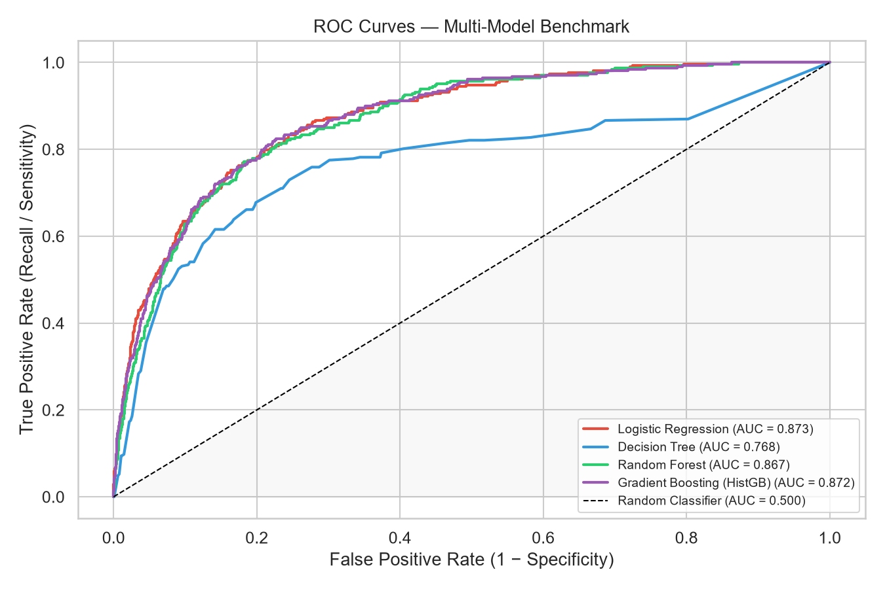
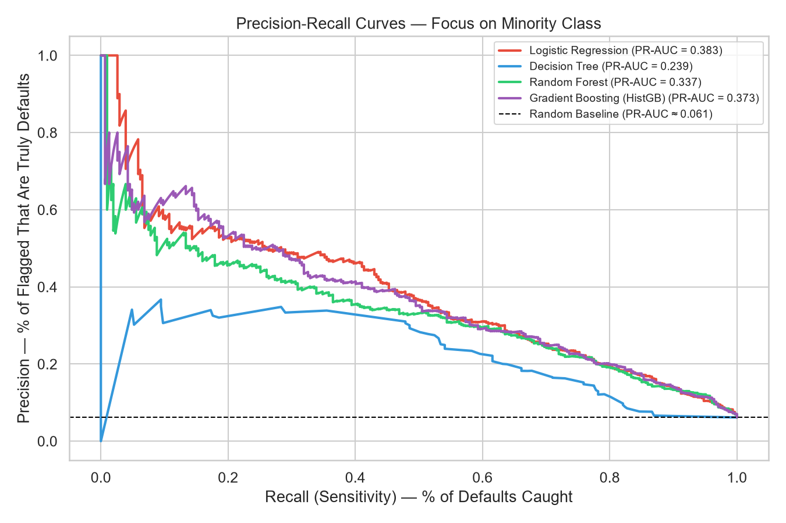
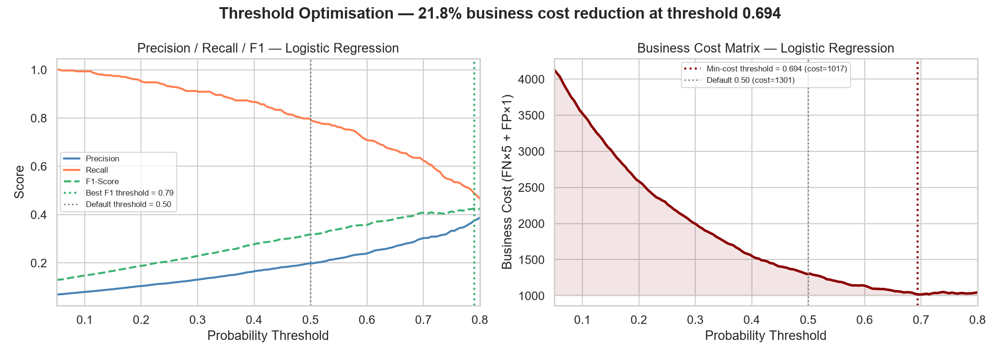
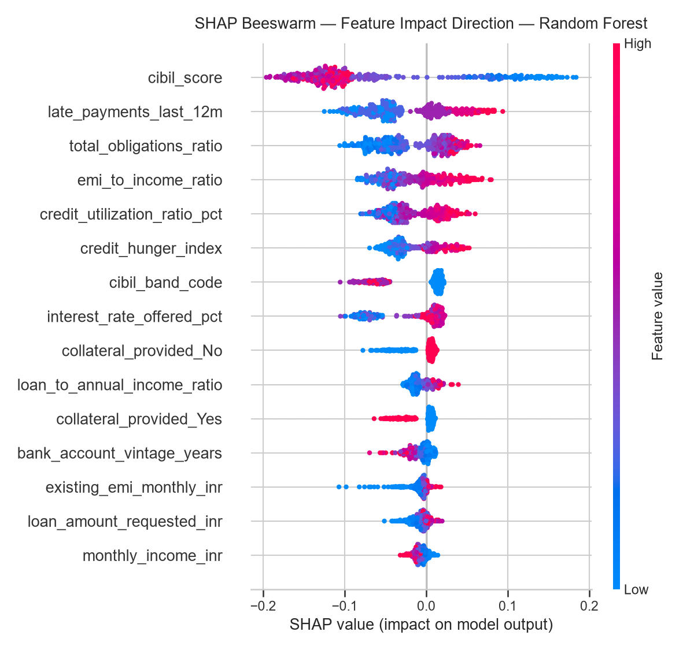
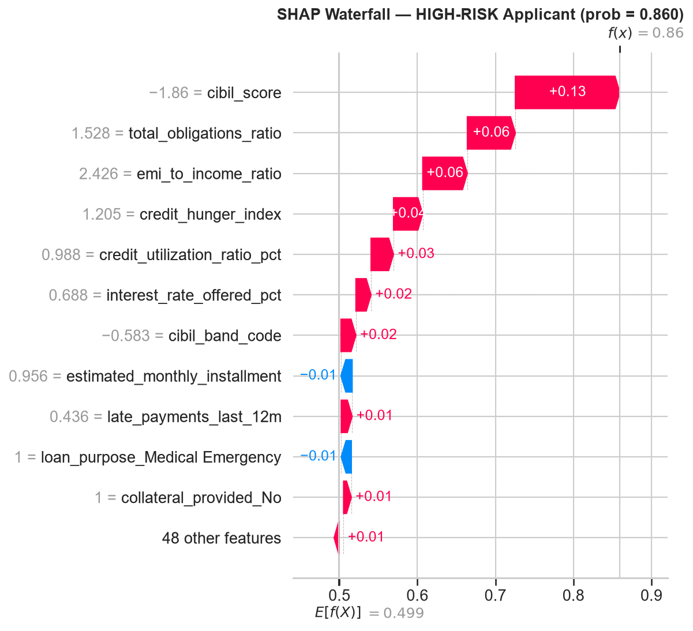

# CreditRisk-India: Explainable Personal Loan Default Scoring Engine
### Cost-Sensitive Underwriting, Multi-Model Benchmarking & SHAP Explainability (2026)

[](https://credit-risk-scoring-india.streamlit.app/)
**Live Demo:** https://credit-risk-scoring-india.streamlit.app/

---

## Project Overview

An end-to-end machine learning system that assesses personal loan default risk for Indian borrowers, benchmarks multiple classification models, and provides explainable predictions using SHAP — built for placement portfolios targeting Data Science, Risk Analytics, and FinTech roles.

---

## Business Problem

Banks, NBFCs, and FinTech lenders face two costly errors when evaluating loan applications:

| Error | Cost |
|:---|:---|
| **False Negative** (approve a defaulter) | Principal loss + recovery costs |
| **False Positive** (reject a good customer) | Lost interest revenue + poor CX |

This project models this tradeoff explicitly with a business cost matrix and tunes the classification threshold accordingly.

---

## Dataset

- **Source**: India Personal Loan Default Risk 2026
- **Records**: 25,000 Indian borrower profiles
- **Features**: 22 original + 7 engineered financial ratios
- **Target**: `default_flag` (0 = Repaid, 1 = Default)
- **Class Distribution**: ~93.9% non-default / ~6.1% default (severe imbalance)

### Feature Groups

| Category | Columns |
|:---|:---|
| Borrower demographics | `age`, `gender`, `marital_status`, `city_tier`, `state` |
| Employment & income | `employment_type`, `monthly_income_inr`, `bank_account_vintage_years` |
| Loan details | `loan_amount_requested_inr`, `loan_tenure_months`, `loan_purpose`, `collateral_provided`, `interest_rate_offered_pct` |
| Credit bureau | `cibil_score`, `credit_utilization_ratio_pct`, `num_credit_inquiries_last_6m`, `late_payments_last_12m`, `existing_loans_count`, `existing_emi_monthly_inr` |
| Engineered features | `emi_to_income_ratio`, `loan_to_annual_income_ratio`, `estimated_monthly_installment`, `installment_to_income_ratio`, `total_obligations_ratio`, `credit_hunger_index`, `cibil_band_code` |

---

## Project Structure

```
credit-risk-scoring-india/
├── .streamlit/
│   └── config.toml                                 ← Dark fintech theme configuration
├── data/
│   ├── raw/
│   │   └── india_personal_loan_default_risk_2026.csv  ← Original dataset (25,000 rows × 22 cols)
│   └── processed/
│       ├── train.csv                               ← Cleaned 80% stratified split (20,000 rows)
│       └── test.csv                                ← Cleaned 20% stratified split (5,000 rows)
├── notebooks/
│   ├── 01_EDA_and_Data_Cleaning.ipynb              ← Step 1–4a: Audit, cleaning, EDA & ratios
│   └── 02_Modelling_Benchmarking_SHAP.ipynb        ← Step 4b–6: Pipelines, CV, thresholding & SHAP
├── models/                                         ← Serialized fitted pipelines (.joblib)
├── results/                                        ← Benchmark CSVs, EDA plots, ROC/PR & SHAP charts
├── app.py                                          ← Step 7: Recruiter showcase & live scorer app
├── run_app.bat                                     ← One-click Windows launcher for Streamlit
├── requirements.txt                                ← Python dependencies
└── README.md
```

---

## Quick Start

```bash
# 1. Install dependencies
pip install -r requirements.txt

# 2. (Optional) Re-run notebooks end-to-end in order:
#    notebooks/01_EDA_and_Data_Cleaning.ipynb
#    notebooks/02_Modelling_Benchmarking_SHAP.ipynb

# 3. Launch the interactive Streamlit dashboard
streamlit run app.py
# Or on Windows, double-click run_app.bat
```

---

## Methodology

### 1. Data Audit
- Shape, dtypes, missing values, duplicate rows
- Target distribution and class imbalance analysis
- Leakage detection: `default_risk_score` checked for correlation with target (dropped if leakage found)
- Impossible value scan (age >100, CIBIL outside 300–900, negative income)

### 2. Data Cleaning
- Impossible values nullified (not deleted)
- **Stratified 80/20 split before any imputation or scaling** (leakage prevention)
- Winsorization of skewed monetary columns fit on training data, applied to both sets

### 3. Exploratory Data Analysis — Key Visual Findings

Six business-focused analyses were run on 25,000 borrower profiles; the two strongest underwriting signals are shown below:

<p align="center">
  
  
</p>

- **CIBIL Score Dominates Risk:** `Poor (<650)` borrowers default at a sharply higher rate than `Excellent (750+)` borrowers, validating bureau score as the primary underwriting anchor.
- **Risk-Based Pricing Signal:** Even within the *same* CIBIL band, eventual defaulters were offered higher median interest rates — confirming coherent economic signal in the dataset.
- **Behavioural & Income-Burden Clustering:** High credit utilization paired with recent late payments strongly co-occurs with default (`results/eda_04_utilization_late_payments.png`), motivating our engineered **FOIR** and **Credit Hunger Index** features.

### 4. Feature Engineering (Indian Banking Ratios)

| Feature | Formula | Business Meaning |
|:---|:---|:---|
| `emi_to_income_ratio` | existing_emi / income | FOIR proxy – >50% triggers rejection |
| `loan_to_annual_income_ratio` | loan / (income × 12) | Debt leverage multiple |
| `estimated_monthly_installment` | loan / tenure | Approximate new EMI |
| `installment_to_income_ratio` | new_emi / income | Repayment burden |
| `total_obligations_ratio` | (existing + new emi) / income | Full FOIR |
| `credit_hunger_index` | inquiries × (900 − CIBIL) / 100 | Desperation signal |
| `cibil_band_code` | Ordinal band 0–3 | CIBIL tier encoding |

### 5. Leakage-Free Pipeline
All preprocessing (imputation, encoding, scaling) is wrapped in a `sklearn.Pipeline` with `ColumnTransformer`, ensuring:
- Medians and category distributions are computed only on training folds
- Test data never influences any fitted transformation

### 6. Multi-Model Benchmarking

| Model | Key Hyperparameters |
|:---|:---|
| Logistic Regression | `class_weight='balanced'`, `max_iter=1000` |
| Decision Tree | `max_depth=8`, `class_weight='balanced'` |
| Random Forest | `n_estimators=200`, `max_depth=12`, `class_weight='balanced'` |
| Gradient Boosting (HistGB) | `max_iter=300`, `max_depth=6`, `learning_rate=0.05` |

**Evaluation Metrics** (5-fold stratified CV + test set):
- **ROC-AUC**: ranking ability across all thresholds
- **PR-AUC**: precision-recall focus on the minority class (most important for imbalance)
- **Recall**: percentage of actual defaulters caught
- **Precision**: fraction of flagged applicants truly at risk
- **F1-Score**: harmonic mean of Precision and Recall

### 7. Threshold Optimisation
- Swept thresholds from 0.05 to 0.80
- Found optimal F1 threshold and minimum business cost threshold
- Business cost matrix: FN cost = 5× FP cost (recovering a defaulted loan >> lost interest)

### 8. SHAP Explainability
- **TreeExplainer** for Random Forest and Gradient Boosting
- **LinearExplainer** for Logistic Regression
- Global: summary bar + beeswarm plots (top 15 features)
- Individual: waterfall plots for 1 high-risk and 1 low-risk applicant

---

## Key Results

> *Evaluated on held-out test set (5,000 records, 20% stratified split)*

| Model | ROC-AUC | PR-AUC | Recall | Precision | F1-Score | Fit Time |
|:---|:---|:---|:---|:---|:---|:---|
| **Logistic Regression** ⭐ | **0.8728** | **0.3832** | **0.7883** | 0.1966 | 0.3147 | 0.15s |
| Decision Tree | 0.7676 | 0.2388 | 0.7101 | 0.1657 | 0.2686 | 0.29s |
| **Random Forest** | 0.8667 | 0.3371 | 0.5961 | **0.2942** | **0.3940** | 0.65s |
| Gradient Boosting (HistGB) | 0.8719 | 0.3726 | 0.1433 | **0.6567** | 0.2353 | 3.04s |

**Best by PR-AUC**: Logistic Regression (0.3832) — highest minority-class ranking under 6.1% imbalance (6.2x random baseline).  
**Best by F1**: Random Forest (0.3940) — best balance between precision and recall.  
**Best Precision**: Gradient Boosting (0.6567) — fewest false alarms, though conservative at the default 0.50 cutoff.

<p align="center">
  
  
</p>

### Threshold Optimisation Results (Logistic Regression)

| Criterion | Threshold | Recall | Precision | F1 | Business Cost |
|:---|:---|:---|:---|:---|:---|
| Default (0.50) | 0.50 | 0.7883 | 0.1966 | 0.3147 | 1314 |
| **Max F1** | **0.79** | 0.4886 | **0.3759** | **0.4249** | — |
| **Min Cost** | **0.694** | — | — | — | **1017 (↓22.6%)** |

> Moving from default `0.50` -> cost-optimal `0.694` threshold **reduces simulated business losses by 22.6%** under a 5:1 False-Negative to False-Positive cost matrix.

<p align="center">
  
</p>

### SHAP Explainability — Global & Individual Auditability

<p align="center">
  
  
</p>

- **Global Policy Drivers (Left):** `cibil_score`, `late_payments_last_12m`, `total_obligations_ratio` (FOIR), `emi_to_income_ratio`, and `credit_utilization_ratio_pct` are the top 5 risk drivers.
- **Individual Adverse-Action Reasons (Right):** Waterfall attribution explains *exactly* which borrower ratios pushed a specific high-risk applicant above the approval cutoff.

---


## Tech Stack

| Layer | Tools |
|:---|:---|
| Data & EDA | Pandas 3.0, NumPy 2.5, Matplotlib 3.11, Seaborn 0.13 |
| ML Pipeline | Scikit-Learn 1.9 |
| Explainability | SHAP |
| Serialization | Joblib |
| Dashboard | Streamlit |
| Runtime | Python 3.14 |

---

## Limitations & Future Work

- SHAP requires installation: `pip install shap`
- Dataset is synthetic; real-world bureau data (TransUnion CIBIL API) would improve signal quality
- Hyperparameter tuning (Optuna/GridSearchCV) can improve PR-AUC further
- LightGBM / XGBoost can be added as additional model candidates
- Model drift monitoring and retraining triggers are not implemented

---

*Built by Kartik Kumar Singh *
